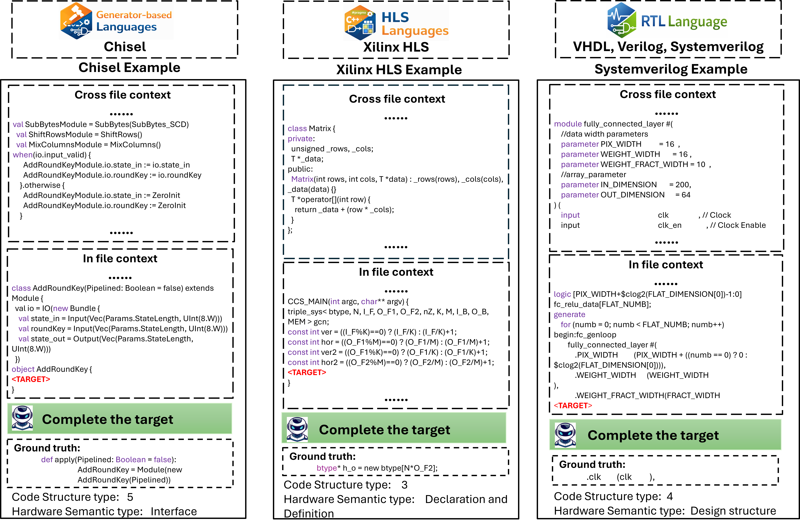

## MHRC-Bench Repository Structure

MHRC-Bench is organized to support the full lifecycle of repository-level hardware code completion research, including benchmark construction, dataset curation across multiple hardware languages, model training, and evaluation.

## Directory Description

### benchmark_construct/
Scripts and utilities for benchmark construction.  
This module is responsible for:
- collecting hardware repositories from GitHub,
- filtering files by license and quality constraints,
- selecting repository-level completion targets,
- annotating targets with code-structure and hardware-semantic labels using concrete syntax tree (CST) analysis.

This corresponds to the benchmark construction procedure described in Section 3 of the paper :contentReference[oaicite:1]{index=1}.

---

### chisel_dataset/
Dataset built from **Chisel (generator-based hardware construction language)** repositories.  
It supports repository-level code completion tasks with both in-file and cross-file context, covering parameterized hardware generation and modular design patterns.

---

### hls_dataset/
Dataset for **High-Level Synthesis (HLS)** code, primarily based on C/C++-style hardware descriptions (e.g., Xilinx HLS).  
This dataset evaluates model performance on high-level, synthesis-oriented hardware programming abstractions.

---

### systemverilog_dataset/
Dataset consisting of **SystemVerilog / Verilog** repositories.  
It focuses on RTL-level hardware designs with complex module hierarchies, interfaces, control logic, and verification-related constructs.

---

### vhdl_dataset/
Dataset built from **VHDL** repositories, covering classical and modern RTL designs.  
It complements SystemVerilog by providing language diversity and structurally distinct hardware description paradigms.

---

### Model_Training/
Training scripts and configurations for supervised fine-tuning on **MHRC-Bench-Train**.  
This module supports repository-level fill-in-the-middle training and is used to improve hardware code completion performance of code LLMs.

---

### Model_evaluation/
Evaluation scripts for **MHRC-Bench-Eval**, including:
- repository-level code completion inference,
- computation of EM, ES, BLEU, and CodeBLEU metrics,
- analysis across hardware languages, code-structure depth, and hardware semantic categories.
